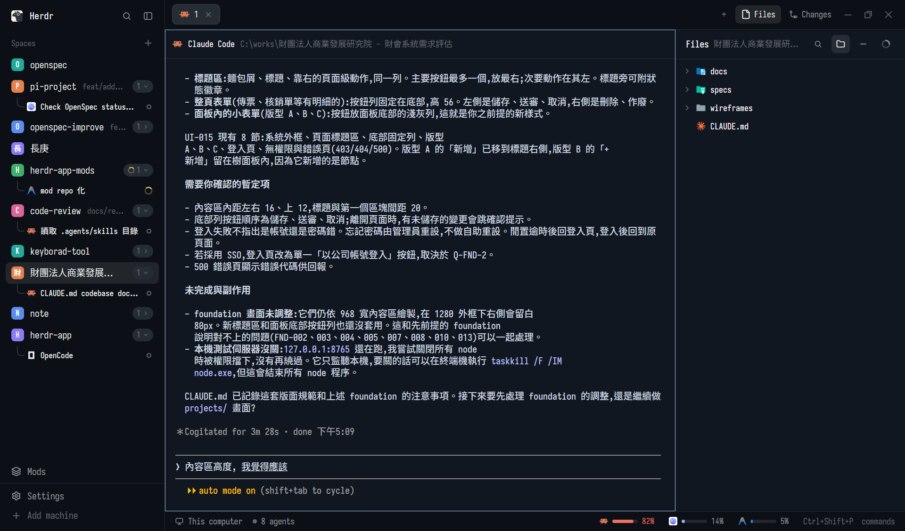

# herdr-my-layout

Custom Herdr IDE layout (`my-layout.json`) featuring a flush, sharp-edged workspace design with aligned 42px headers across the main terminal/editor pane and right-side panels.



## Layout Highlights

- **Left Sidebar (`268px`)**: `workspace-chrome` brand/footer + `spaces-tree` hierarchical space & agent tree.
- **Top Tab Bar (`42px`)**: `pierre-tree-files-tab` with file icons and quick actions.
- **Main Work Body (`padding: 0`, `gap: 0`)**:
  - **Main Pane (`radius: 0`, `gap: 0`)**: Sharp-edged terminal/editor panes with a `41px` header (`+ 1px` top border = `42px` total) aligned with the right panels.
  - **Right Panel (`368px`)**: `pierre-tree-files` (Files) & `git` (Changes) stack.
- **Status Bar (`28px`)**: `agent-usage`.

## Installation

Copy `layouts/my-layout.json` into your Herdr config directory:

```powershell
Copy-Item -Force "layouts/my-layout.json" "$env:USERPROFILE\.config\herdr-app\layouts\my-layout.json"
```

Then switch to `my-layout` in Herdr (`ctrl-shift-l` or Settings).

## Referenced Mods

- `spaces-tree` (`herdr-spaces-tree`)
- `pierre-tree-files-tab` & `pierre-tree-files` (`herdr-pierre-tree-files`)
- `git` (`herdr-git`)
- `agent-usage` (`herdr-agent-usage`)
