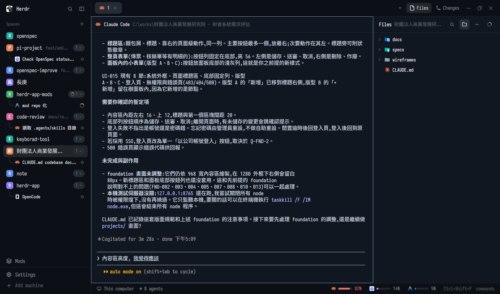

# my-layout

A flush, sharp-edged workspace layout for Herdr that pairs a 268px hierarchical space-and-agent sidebar with a 42px icon-aware tab strip, a 0px-radius terminal/editor stage with a 41px pane header (+ 1px top border = 42px), a 368px right-side Files/Changes stack, and a 28px live agent-usage status bar.

## What you see

The window (`root`, `"type": "row"`, `"background": "canvas"`, `"terminal_padding": [14, 12]`) is split left to right into two visible columns (`sidebar` and `work`):

1. **Left Sidebar (`sidebar`, 268px fixed, `background: "chrome"`, `resizable: false`, min 44px, max 480px)**:
   - **Brand header (`brand`, 46px, `window_drag: true`)**: Shipped `workspace-chrome` mod showing the Herdr mark, search button, and sidebar toggle.
   - **Spaces & Agents Tree (`spaces`, `weight: 1`, min 90px)**: `spaces-tree` mod showing Spaces grouped by machine with 18px colored initial badges (`rounded(5)`), truncated space names, optional git branch/ahead/behind tail, and a `flex_none` capsule pill (`rounded(9)`, 18px tall, `bg(t.raised)`) showing total active + dormant agent count, working spinner (`t.working`), blocked dot (`t.blocked`), and fold chevron. Beneath each expanded space, live agents (27px tall, `pl(30)`), dormant sessions (27px tall, `pl(30)`), and background sub-agents (25px tall, `pl(50)`) share identical rounded tree guide rails (`w(11)`, `h(14)`, `rounded_bl(6)`), differing only by +20px indent.
   - **Sidebar footer (`sidebar-footer`, 68px)**: Shipped `workspace-chrome` with `props: { "footer": true }` (Mods, Settings, Add machine).
   - *(Hidden slots)*: `over9k` (268px, `"hidden": true`), `agents` (`"hidden": true`), and `sidebar-mods-btn` (34px, `"hidden": true`).

2. **Right Workspace Column (`work`, `type: "column"`, `resizable: false`)**:
   - **Tab Bar (`tabs`, 42px, `window_drag: true`)**: `pierre-tree-files-tab` mod showing active space tabs with program/file-extension icons, dirty indicators, `+` new-tab menu, Files/Changes panel toggles, and window controls.
   - **Work Body (`work-body`, `type: "row"`, `"padding": 0`, `"gap": 0`)**:
     - **Main Stage (`main`)**: Active tab panes (`"tab": "active"`) wrapped with `"lone": true`, `"radius": 0`, `"gap": 0`, `"background": "background"`, `"border": { "width": 1, "color": "border" }`, `"focus": { "width": 1, "color": "accent" }`, and a top `pane` header (`"height": 41`, `"reveal": "always"`, `"position": "top"`). The 1px top border + 41px header totals 42px so its bottom divider aligns flush with the right panel's 42px header. Hosts terminal panes and `pierre-tree-files-editor` mod panes.
     - **Side Panel (`panel`, 368px, min 280px, max 900px, `"hidden": true` until toggled)**: A `stack` (`panel-body`, active `"files"`) switching between:
       - `files` (`pierre-tree-files`): Sharp-edged (`overflow_hidden`, `border_l(1)` `t.border`, no `rounded(10)`) file tree with 42px header, `ctrl-f` search bar, folder loading spinner (`spin(900)` + `Loading…`), and click-to-open in `pierre-tree-files-editor`.
       - `changes` (`git`): Sharp-edged (`K.panel` with `border_l(1)` `t.border` or `t.accent` when focused, no `rounded(10)`) commit graph and working-tree changes panel with a 42px header.
   - **Status Bar (`status`, 28px)**: `agent-usage` mod displaying live quota/usage meters across providers.

## How it behaves

- **Agent Statuses**:
  - `working`: Animated spinner (`spinner.svg`, `.spin(900)`, `t.working`) in the space pill and agent row.
  - `blocked`: Solid dot (`t.blocked`) in the space pill and agent row.
  - `done`: Attention indicator until focused.
  - `idle`: Subtle ring/dot (`t.dim` / `t.muted`).
- **Agent Naming (`spaces-tree`)**: `smartAgentName` prioritizes meaningful agent task titles (`agent.title`, filtering out shell paths, bare program names, and `<program> <cwd>` defaults), falling back to user-named tabs (`tabInfo.named && tabInfo.name`), then `program.name`, then `Tab <n>`.
- **Clicks, Keys, and Hover**:
  - Clicking a space selects it (`space.select`); dragging reorders within the same machine (`space.move`).
  - Clicking the agent count pill folds/unfolds that space's agents (`spaces.agents_folded` in `localStorage`).
  - Clicking a live agent focuses its pane/terminal (`pane.focus`); clicking a sub-agent focuses its pane or opens a peek overlay (`terminal.peek`); clicking a dormant session wakes/resumes it (`claude --resume` / `agy --conversation` / `tab.new`).
  - Right-clicking agents or sub-agents opens the `agent-tab-menu` popup overlay.
  - Clicking a file in `pierre-tree-files` opens or focuses `pierre-tree-files-editor` (`ctrl-s` / `cmd-s` saves via `bind_keys` + `on_action`).

## Built from

- **Layout (`layouts/my-layout.json`)**: Cloned from `main` (`0.1.14`), modified with `work-body` `padding: 0`, `gap: 0`, `main.content.pane` `radius: 0`, `gap: 0`, `header.height: 41`.
- **Shipped mods**: `workspace-chrome` (header & `props: { "footer": true }`), `pane`, `agents` (hidden), `mods-nav-btn` (hidden).
- **Custom mods in `mods/`**:
  - `spaces-tree` + companion popup `agent-tab-menu`
  - `pierre-tree-files-tab`
  - `pierre-tree-files` + companion editor pane `pierre-tree-files-editor`
  - `git` (`K.panel` updated to `border_l(1)` with no `rounded(10)`)
  - `agent-usage`
  - `over9k` (hidden block in `root`)
- **Herdr APIs & External Tools**: Uses `spaces()`, `panes()`, `terminals()`, `agents()`, `focused()`, `theme()`, `shared()`, `run()` (`space.select`, `space.move`, `tab.new`, `pane.focus`, `pane.split`, `terminal.peek`, `terminal.keep`, `terminal.kill`), `openOverlay()`, `exec()`, and `hc` CLI (`hc send`, `hc ls`).

## Watch out

- **Mod-level borders override layout**: `pierre-tree-files` (`mods/pierre-tree-files/main.js`) and `git` (`mods/git/kit.js`) originally draw `.rounded(10).border_1()` on their root containers. Both are adjusted here to `border_l(1)` without `rounded(10)` so they sit flush against the 0px-radius `main` pane without a double 2px seam.
- **Header alignment math**: `main.content.pane` has a 1px top border (`"border": { "width": 1 }`), so `"header": { "height": 41 }` is required to match the 42px headers of `pierre-tree-files` and `git`.
- **Hidden blocks**: `over9k`, `agents`, and `sidebar-mods-btn` remain in the node tree with `"hidden": true` and do not render unless unhidden.
- **Platform assumptions**: Local shell/file operations in `pierre-tree-files`, `pierre-tree-files-editor`, `spaces-tree`, and `git` target Windows (`pwsh`, `PowerShell`, Git for Windows).

## Done when

1. `herdr-app check` passes with exit code 0 on all mods in `mods/` (`spaces-tree`, `agent-tab-menu`, `pierre-tree-files-tab`, `pierre-tree-files`, `pierre-tree-files-editor`, `git`, `agent-usage`, `over9k`).
2. `layouts/my-layout.json` loads in Herdr (`herdr-app do layout.switch '{"name":"my-layout"}'`) with no `layout.error`.
3. Visual verification (`herdr-app shot`) confirms:
   - `work-body` has zero outer padding and zero gap between `main` and `panel`.
   - `main`, `Files`, and `Changes` have sharp 90-degree corners (`radius: 0`) and a single 1px vertical divider between `main` and `panel`.
   - The `main` pane header bottom border (1px + 41px) aligns flush with the 42px header bottom border of `Files` / `Changes`.
   - Long space names truncate with `...` without clipping the right-side agent count pill.
